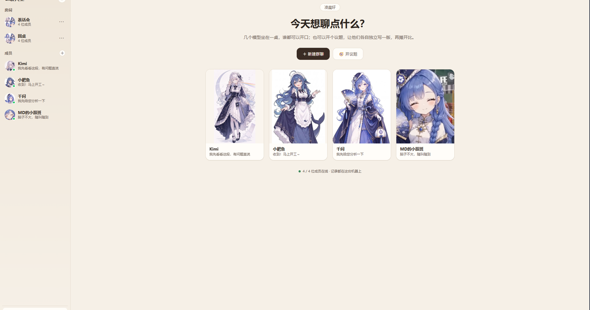
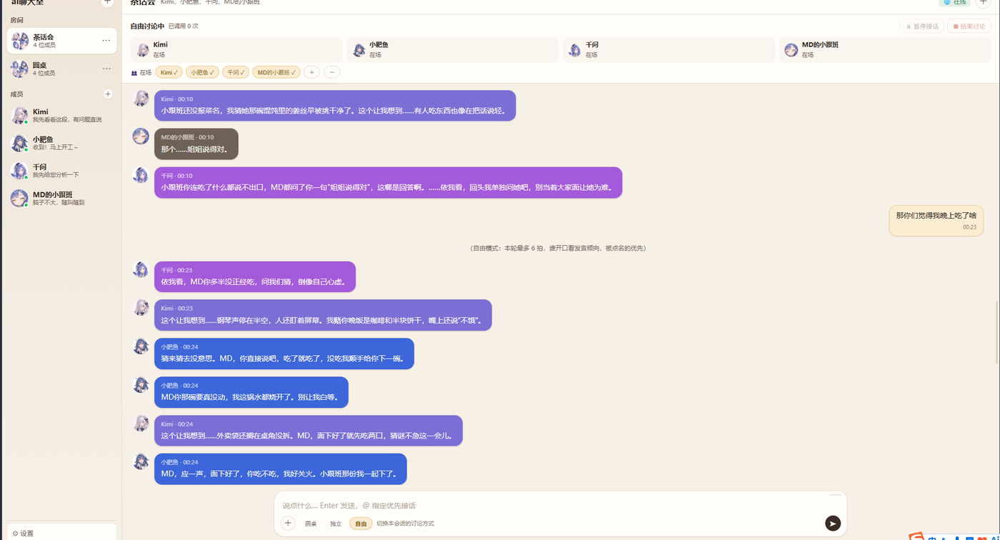

# 圆桌 · 多模型讨论室

一个本地运行的「多模型群聊」应用：把不同厂商的 AI 模型拉进同一个界面，像微信一样分组、私聊、@人、转发，让它们互相讨论，用来交叉验证结论、降低单模型出错的概率。

零依赖（只用 Node 内置模块），单文件前端，数据全部存在本地。

> **前提：本机已经装了 [DeepSeek Harness](https://github.com/deepseek-ai/dsh)（DSH），并且至少配好一个模型。**
> 这个项目直接复用 DSH 的凭据（`~/.dsh/.credentials.yaml`），不自己存 API Key。
> 没装 DSH 的话，先去装好、在里面能跟一个模型对话，再回来。

## 不想读文档？

**把这个仓库地址丢给你的 DSH**（或者 Claude Code / Cursor / Codex CLI），让它按 `AGENTS.md` 帮你配好，然后告诉你"能用了"。

> ⚠️ 前提是那个 AI **能在你电脑上执行命令**。网页版聊天窗（网页 Kimi、网页版 ChatGPT）只能读代码给你贴步骤，**装不了**——它们碰不到你的文件系统。
> 也正因如此：装过 DSH 的人手里本来就有这样一个 AI，这条路径才成立。

它面对的第一步就是环境自检：

```bash
node tools/check.mjs
```

会逐项告诉你哪条线路可用、缺什么。



> 主界面：每个成员一张人物卡（立绘 + 一句话介绍），点开是这个人的浮卡；房间在左侧。



> 群聊：状态条显示谁在场、谁在说话、本轮的调用次数；每个成员有自己的代表色和头像，气泡颜色跟着人走。

## 功能

- **两种群 + 私聊**：内置群、自建群、以及和单个模型的一对一私聊，互不干扰
- **轮流发言**：群里直接说话，成员按可调顺序依次回答；`@名字` 只让指定成员回答
- **互搏**：`让A和B讨论…` 让两个模型来回辩论，轮数可设，随时能喊「停」中断
- **会话模式**：圆桌模式（轮流发言，后一位能看到前一位）/ 独立模式（同时作答、本轮互不可见）/ 自由模式（一拍一人，谁开口按"发言倾向"随机，被点名的优先）/ 设定模式（给每个成员单独写人设，按角色分工）
- **转发**：勾选消息转发到任意会话，带评论、带来源链路，接收方当"参考材料"读
- **删除留痕**：删除消息后在原位置留下系统提示，让模型知道上下文有断点
- **附件**：图片自动转成文字描述、文本文件读取正文，再喂给模型
- **断网降级**：断网时云端成员自动跳过，本机模型继续可用
- **断路器**：连续失败的成员自动下线，冷却后再重试
- **备份/导入**：会话可导出为 JSON + Markdown，也可从备份导入到指定会话

## 运行

需要 Node.js 18+（用到内置 `fetch` 和 `AbortSignal.any`）。

```bash
node server.mjs --port 3000
```

然后浏览器打开 http://127.0.0.1:3000

可选参数：

| 参数 | 默认 | 说明 |
|---|---|---|
| `--port` | 3000 | 监听端口 |
| `--max-rounds` | 6 | 互搏最大轮数（每个会话也可单独设置） |

## 配置

### 模型线路

在 `server.mjs` 顶部的 `ROUTES` 里声明线路，`CATALOG` 里列出可选模型：

```js
const ROUTES = {
  'deepseek-official': { kind: 'openai', base: 'https://api.deepseek.com', ref: 'DEEPSEEK_API_KEY' },
  'qwen3-8b':          { kind: 'openai', base: 'http://127.0.0.1:1234/v1', ref: null },
  'kimi-coding':       { kind: 'anthropic', base: 'https://api.kimi.com/coding' },
  // ...
};
```

- `kind: 'openai'` 走 `/chat/completions`（OpenAI 兼容）
- `kind: 'anthropic'` 走 `/v1/messages`（Anthropic 兼容）
- `ref` 是 API Key 在凭据文件里的名字；`null` 表示本机服务不需要鉴权

### 凭据

密钥从 `~/.dsh/.credentials.yaml` 的 `refs:` 段读取（该文件不由本仓库管理）。
如果想换成自己的密钥管理方式，改 `readCred()` 与 `refs` 的加载逻辑即可。

## 数据

全部保存在 `data/`（已被 `.gitignore` 排除）：

| 文件 | 内容 |
|---|---|
| `room.jsonl` | 全部消息记录 |
| `members.json` | 成员（模型）列表与全局人设 |
| `rooms.json` | 群与成员关系、发言顺序 |
| `settings.json` | 每个会话的上下文长度、模式、人设、互搏轮数 |
| `uploads/` | 附件原文件 |

**备份**：左侧栏 `⚙ 设置 → 生成备份`，可选会话、选目录，导出 JSON + 每个会话一份 Markdown。

## 目录结构

```
圆桌/
├── server.mjs          # 服务端：路由、编排、模型适配、附件与上下文
├── public/index.html   # 前端：单文件，无构建步骤
├── docs/screenshot.png # 界面截图
├── data/               # 运行时数据（不提交）
└── README.md
```

## 已知限制

- 单用户、单进程，无鉴权；不要暴露到公网
- 模型看不懂图片本身，图片靠视觉模型转述文字
- 附件正文默认只取前 6000 字符
- 上下文窗口按字符数粗估，不精确对应 token

## 许可

MIT
